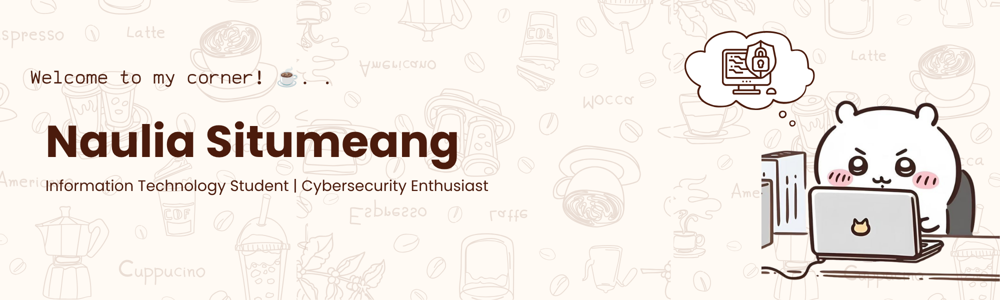

## Hi there! ^^☕👋🏻

#### ☕ About Me
I'm an Information Technology undergraduate at Universitas Sumatera Utara (batch 2024), interested in cybersecurity. I enjoy solving CTF challenges and learning how systems break (legally) so I can understand how to protect them!

#### 🔭 What I'm Up To
- 🔐 Exploring cybersecurity: web exploitation, cryptography, reverse engineering, and forensics
- 📝 Writing up CTF challenges I've solved
- 🐍 Practicing Python for security scripting
- 🌱 Applying to GDGoC USU Core Team

#### 🛠️ Skills & Tools
##### **Security** 
 

##### **Systems** 
 

##### **Security Platforms**
 

##### **Languages & Web**

##### **Design**

#### 🏆 Highlights
- 🥇 1st Best Project, Cybersecurity Pathway, GDGoC USU (2026)
- 🚩 Solved 4 CTF challenges: SQL Injection, XOR cipher, ELF reverse engineering, LSB steganography
- 🎨 UI/UX: "Lost and Found" web app concept, CodeFest 001

#### 📌 Featured Repos
- [ctf-writeups](link): how I solved the challenges
- [python-scripts](link): small scripts for security tasks

#### 📫 Connect With Me
   
 

---
*Brewing knowledge in cybersecurity ☕*
